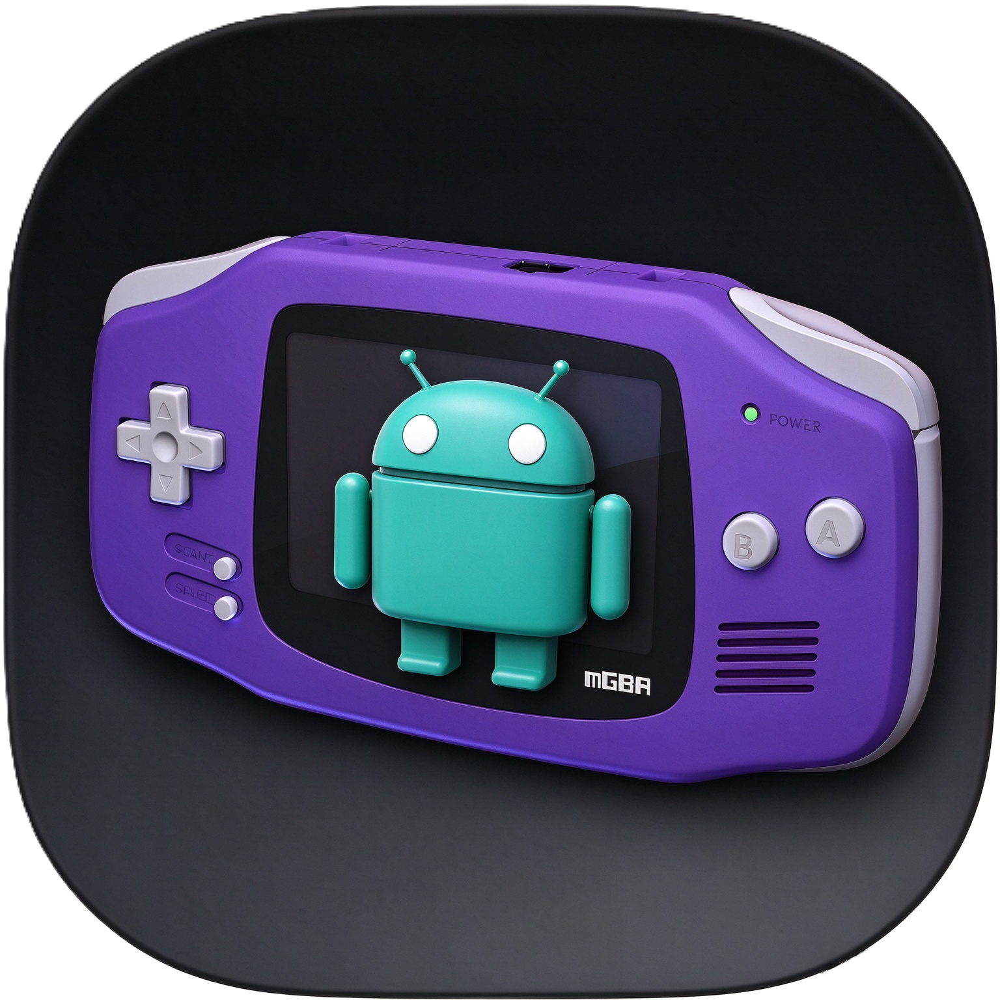

# mGBA-Android

<p align="center">
  
</p>

<p align="center">
  <b>基于 mGBA Libretro 核心的 Android GBA / GB / GBC 模拟器前端</b><br>
  Kotlin · Jetpack Compose · Material 3 · OpenGL ES
</p>

---

## 简介

mGBA-Android 是一个面向 Android 的 Game Boy Advance / Game Boy / Game Boy Color
模拟器前端，使用 [mGBA](https://github.com/mgba-emu/mgba) 的
[Libretro 核心](https://github.com/libretro/mgba)运行游戏。

项目采用「平台无关 core + Android 平台实现 + Compose UI」的分层结构：
仿真循环、音频泵、存档仓库、输入抽象与设置模型都不依赖 Android SDK，
Android 层只负责 SAF/Intent、SurfaceView、AudioTrack 与生命周期胶水。

> 本项目不附带任何 ROM、BIOS 或游戏数据。请使用你合法持有的 ROM 文件。

## 功能

- **游戏库**：导入单个 ROM 或 ZIP（自动解压第一个 GBA/GB/GBC 条目），
  支持重命名、删除与删除关联存档。
- **即时存档**：多个存档槽位、自动存档、退出时自动保存。
- **电池存档**：SRAM 与 RTC 按 ROM 的 SHA-256 隔离，退出、暂停与每 60 秒定时落盘。
- **金手指**：GameShark / Action Replay、CodeBreaker、Raw 直写与自动检测；
  兼容 My Boy 的 Raw 写法（`ADDR VALUE`、`ADDRVALUE`、`ADDR:VALUE`）。
- **变速**：0.2x 慢放到 16x 快进，共 14 个常用档位（含 1.25x、1.75x），
  游戏内菜单拖动即时调整。
- **画面**：线性过滤、全屏拉伸、横竖屏、屏幕刷新率（30/60/90/120/144 Hz）、
  内置 LCD/扫描线/点阵着色器，并支持通过 SAF 加载自定义 GLSL 片元着色器。
- **虚拟手柄**：可拖拽、缩放的布局编辑器，支持方向轮盘、AB、L/R、Start/Select
  与组合键，以及可重新放置的「更多」菜单键。
- **调试浮层**：左上角显示仿真帧率、绘制帧率、帧耗时、丢帧/秒，
  并可单独显示当前变速状态（快进橙色、慢放蓝色、正常灰色）。
- **设置中心**：视频、音频、输入、ROM 信息、系统信息、其他、关于。

## 环境要求

| 项目 | 要求 |
| --- | --- |
| JDK | 17 或更高（推荐 21） |
| Android SDK | Platform 36（`compileSdk = 36`） |
| Gradle | 9.5.1（仓库自带 Wrapper） |
| 最低系统 | Android 11（API 30） |
| ABI | `arm64-v8a` |

构建 Android 应用**不需要** NDK、CMake 或 mGBA 源码：JNI 桥
（`libmgba_frontend.so`）与 mGBA Libretro 核心（`libmgba_libretro.so`）
已放在 `app/src/main/jniLibs/arm64-v8a/`，`./gradlew :app:assembleDebug`
即可完成构建。

## 构建

```bash
# Debug
./gradlew :app:assembleDebug

# Release（未配置签名时产出 unsigned APK）
./gradlew :app:assembleRelease
```

Windows 下使用 `gradlew.bat`。构建产物位于：

```text
app/build/outputs/apk/debug/app-debug.apk
app/build/outputs/apk/release/app-release.apk
```

首次构建需要联网下载 Gradle 与 Maven 依赖。

### 发布签名（可选）

在项目根目录创建 `keystore.properties`（已被 `.gitignore` 忽略）：

```properties
storeFile=C:/path/to/release.jks
storePassword=your-store-password
keyAlias=your-key-alias
keyPassword=your-key-password
```

存在该文件时 `assembleRelease` 会自动签名；不存在时保持未签名，
不会影响其他开发者构建。

### 重新编译 native 层（可选）

预编译的 `.so` 已随仓库提供，只有修改 `native/` 或升级 mGBA 核心时才需要：

```powershell
# 只编译 JNI 前端（使用已有的 libmgba_libretro.so）
.\scripts\build-native.ps1 -SkipCore

# 重新编译 mGBA Libretro 核心（需要 mgba-source/mgba(mGBA-Libretro) 源码树）
.\scripts\build-mgba-libretro.ps1

# 同时编译核心与前端
.\scripts\build-native.ps1
```

脚本默认使用 NDK `27.0.12077973` 与 SDK 自带 CMake `3.22.1`，
可通过 `-NdkVersion` / `-CmakeVersion` / `-AndroidSdk` 覆盖。

> `mgba-source/` 是本地参考源码，不提交到本仓库；脚本只在重新编译核心时需要它。

## 项目结构

```text
app/src/main/java/com/mgba/bingbaihanji/
  core/                     平台无关层
    emulation/              仿真循环、核心接口、libretro 选项
    audio/                  音频泵与环形缓冲区消费
    input/                  按键动作、虚拟手柄布局、映射模型
    cheat/                  金手指模型与解析器
    storage/                ROM 目录、存档格式与仓库
    settings/               设置模型、速度档位
    session/                游戏会话编排（加载/暂停/存档/变速）
    perf/                   帧率与丢帧统计
  platform/android/         Android 实现
    emulation/              JNI 核心、核心选项持久化
    audio/                  AudioTrack 输出
    video/                  GLSurfaceView / OpenGL ES 渲染器与着色器
    storage/                SAF、文件存储
    input/ settings/ cheat/ SharedPreferences 存储
  ui/                       Jetpack Compose 界面
    settings/               视频/音频/输入/ROM/系统/关于等设置页
    input/                  虚拟手柄与布局编辑器
    cheat/                  金手指编辑
  native/ (native/)         JNI 桥与 Libretro 会话（C）
  emulator/NativeEmulator.kt JNI 声明（包名固定）
```

## 开源地址

- **本项目**：<https://github.com/bingbaihanji/mgba-android>
- **mGBA（上游）**：<https://github.com/mgba-emu/mgba>
- **mGBA Libretro 核心**：<https://github.com/libretro/mgba>

## 作者与交流

- 作者：**bingbaihanji**
- 邮箱：<bingbaihanji@gmail.com>
- QQ：2761868857
- 交流群：**1128889210**、**544070859**

## 许可

- mGBA 核心与 Libretro 适配层遵循 **MPL-2.0**。
- AndroidX、Jetpack Compose、Kotlin 遵循 **Apache-2.0**。
- 详见 [THIRD_PARTY_LICENSES.md](THIRD_PARTY_LICENSES.md)。

本应用不包含任何 ROM、BIOS 或游戏数据。
